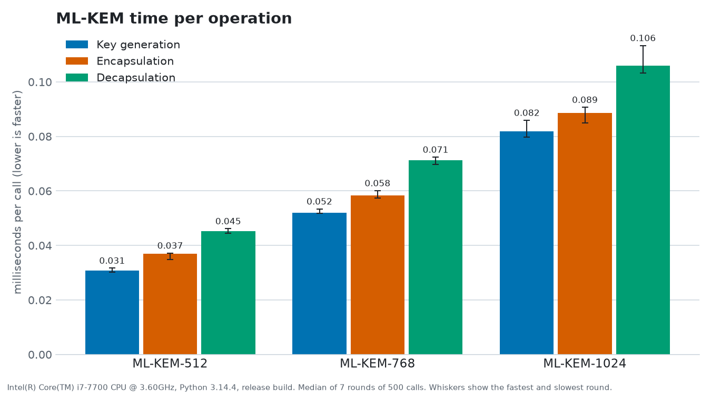

# PyKyber

Post-quantum key encapsulation for Python: ML-KEM (FIPS 203), written in Rust with no third-party crypto crate and no Python dependencies. Licensed MIT OR Apache-2.0.

## Install

```bash
pip install pykyber
```

Python 3.8 or newer. Prebuilt wheels cover Linux (glibc and musl), macOS and Windows.

## Quick start

```python
import pykyber

alice = pykyber.ML_KEM_768()                               # Alice makes a keypair
bob = pykyber.ML_KEM_768.encapsulate(alice.public_key)     # Bob encapsulates against her public key
secret = alice.decapsulate(bob.ciphertext)                 # Alice recovers the same 32-byte secret
assert secret == bob.shared_secret
```

`ML_KEM_512`, `ML_KEM_768` (NIST's default) and `ML_KEM_1024` work the same way.

## Sizes

| Class | Public key | Secret key | Ciphertext | Shared secret |
|-------|------------|------------|------------|---------------|
| `ML_KEM_512` | 800 bytes | 1632 bytes | 768 bytes | 32 bytes |
| `ML_KEM_768` | 1184 bytes | 2400 bytes | 1088 bytes | 32 bytes |
| `ML_KEM_1024` | 1568 bytes | 3168 bytes | 1568 bytes | 32 bytes |

## Performance

Time per call from Python on an Intel Core i7-7700 (Python 3.14, release build, median of 7 rounds of 500 calls). One machine, one run.

| Class | Key generation | Encapsulation | Decapsulation |
|-------|----------------|---------------|---------------|
| `ML_KEM_512` | 0.031 ms | 0.037 ms | 0.045 ms |
| `ML_KEM_768` | 0.052 ms | 0.058 ms | 0.071 ms |
| `ML_KEM_1024` | 0.082 ms | 0.089 ms | 0.106 ms |



## More

Everything else is in [docs/](docs/index.md): the [API reference](docs/api.md), the [guide for teams adopting PyKyber](docs/enterprise.md) (licensing, supply chain, security status, upgrade policy), and [SECURITY.md](SECURITY.md) for reporting vulnerabilities.

## Deprecated: Kyber

`Kyber512`, `Kyber768` and `Kyber1024` (round-3 CRYSTALS-Kyber) still work and give the same output as 1.0.5, but they are deprecated and emit a `KyberDeprecationWarning`. They are not interoperable with ML-KEM. See the [migration guide](docs/migration.md).
