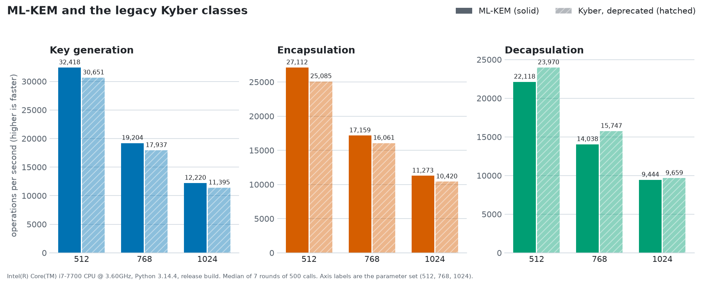

# PyKyber

PyKyber is a Python library for post-quantum key encapsulation. It implements ML-KEM (FIPS 203) in Rust, with its own Keccak and number-theoretic transform and no third-party crypto crate, and ships Python bindings built with PyO3. The old round-3 CRYSTALS-Kyber classes are still in the package but deprecated.

ML-KEM and round-3 Kyber give different shared secrets, so they cannot talk to each other. If you are moving from Kyber, read the [migration guide](docs/migration.md) first.

## Install

```bash
pip install pykyber
```

It needs Python 3.8 or newer and has no runtime dependencies.

## Quick start

```python
import pykyber

# Alice makes a keypair and sends Bob her public key.
alice = pykyber.ML_KEM_768()

# Bob encapsulates against it and sends the ciphertext back.
bob = pykyber.ML_KEM_768.encapsulate(alice.public_key)

# Alice decapsulates and ends up with the same 32-byte secret.
secret = alice.decapsulate(bob.ciphertext)
assert secret == bob.shared_secret
```

ML-KEM-768 is the set NIST recommends by default (FIPS 203, section 8). `ML_KEM_512` and `ML_KEM_1024` work the same way.

## Using the classes

A class instance is a keypair. Creating one generates the keys.

```python
keypair = pykyber.ML_KEM_768()
public_key = keypair.public_key        # bytes
secret_key = keypair.secret_key        # bytes
public_key, secret_key = keypair       # tuple unpacking works too

# A 64-byte seed (d || z) gives the same keys every time. Keep the seed secret.
keypair = pykyber.ML_KEM_768(seed=bytes(range(64)))
keypair.seed                           # None for randomly generated keypairs

result = keypair.encapsulate()
ciphertext, shared_secret = result     # or result.ciphertext, result.shared_secret

keypair.decapsulate(ciphertext)        # the same shared_secret
```

The static forms work without a keypair object, which is what the two sides of a real exchange use:

```python
result = pykyber.ML_KEM_768.encapsulate(public_key)
secret = pykyber.ML_KEM_768.decapsulate(result.ciphertext, secret_key)
keypair = pykyber.ML_KEM_768.from_keys(public_key, secret_key)
```

Keys, ciphertexts and shared secrets also come as hex and base64 (`keypair.public_key_hex`, `keypair.secret_key_b64`, `result.ciphertext_hex`) and `keypair.to_dict()` returns the hex keys. The [API reference](docs/api.md) lists everything.

## Sizes

| Class | Public key | Secret key | Ciphertext | Shared secret |
|-------|------------|------------|------------|---------------|
| `ML_KEM_512` | 800 bytes | 1632 bytes | 768 bytes | 32 bytes |
| `ML_KEM_768` | 1184 bytes | 2400 bytes | 1088 bytes | 32 bytes |
| `ML_KEM_1024` | 1568 bytes | 3168 bytes | 1568 bytes | 32 bytes |

The deprecated Kyber classes use the same sizes, so you cannot tell a Kyber key from an ML-KEM key by its length.

## Errors

Bad input raises `KyberError` or one of its subclasses.

```python
try:
    pykyber.ML_KEM_768.encapsulate(b"too short")
except pykyber.KyberError as e:
    print(e)  # Invalid public_key for ML-KEM-768.encapsulate: expected 1184 bytes, got 9.
```

The subclasses you are most likely to meet:

- `InvalidInputError` for a key, ciphertext or seed of the wrong size.
- `InvalidEncapsulationKeyError` and `InvalidDecapsulationKeyError` for keys that fail the checks in FIPS 203, sections 7.2 and 7.3.
- `AlgorithmMismatchError` when you pass a `Kyber*` keypair to an `ML_KEM_*` method, or a keypair from another ML-KEM set.

A well-formed ciphertext that was not made for your key does not raise. Decapsulation returns a different, random-looking secret instead, which is how FIPS 203 does implicit rejection.

## The Kyber classes are deprecated

`Kyber512`, `Kyber768` and `Kyber1024` implement round-3 CRYSTALS-Kyber. They still work and their output matches 1.0.5. The first use of one in a process emits a `KyberDeprecationWarning`. Python hides `DeprecationWarning` unless it comes from `__main__`, so run with `-W default::DeprecationWarning` if you want to see it. The [migration guide](docs/migration.md) explains how to switch.

## Security status

The ML-KEM code passes the official NIST ACVP vectors, the C2SP CCTV vectors and the Wycheproof vectors, and it matches an independent implementation in a differential test that runs only in development. Nobody outside the project has audited it. PyKyber makes no constant-time claim: the checks so far are evidence, not a proof, and [SECURITY.md](SECURITY.md) records what was checked, what was fixed and what is still open, such as stack copies left by the Keccak permutation.

Secret keys and shared secrets come back as Python `bytes`, which are immutable and cannot be wiped from memory. To report a vulnerability, follow [SECURITY.md](SECURITY.md).

## Performance

These numbers are time per call from Python, including the binding overhead, on an Intel Core i7-7700 at 3.6 GHz with Python 3.14 and a release build. Each figure is the median of 7 rounds of 500 calls.

| Class | Key generation | Encapsulation | Decapsulation |
|-------|----------------|---------------|---------------|
| `ML_KEM_512` | 0.031 ms (32,418/s) | 0.037 ms (27,112/s) | 0.045 ms (22,118/s) |
| `ML_KEM_768` | 0.052 ms (19,204/s) | 0.058 ms (17,159/s) | 0.071 ms (14,038/s) |
| `ML_KEM_1024` | 0.082 ms (12,220/s) | 0.089 ms (11,273/s) | 0.106 ms (9,444/s) |
| `Kyber512` | 0.033 ms (30,651/s) | 0.040 ms (25,085/s) | 0.042 ms (23,970/s) |
| `Kyber768` | 0.056 ms (17,937/s) | 0.062 ms (16,061/s) | 0.064 ms (15,747/s) |
| `Kyber1024` | 0.088 ms (11,395/s) | 0.096 ms (10,420/s) | 0.104 ms (9,659/s) |

ML-KEM and the old Kyber classes are within about 10 percent of each other. ML-KEM is slightly faster at key generation and encapsulation and slightly slower at decapsulation.




To run the benchmark yourself, use a release build, because a debug build is many times slower. The make target does that for you:

```bash
pip install -r requirements-dev.txt -r performance-tests/requirements.txt
make benchmark
```

`make benchmark` builds the release extension, runs the timings and rewrites the two charts and `performance-tests/results.json`.

## License

This is free and unencumbered software released into the public domain. See [LICENSE](LICENSE) or <https://unlicense.org>.
