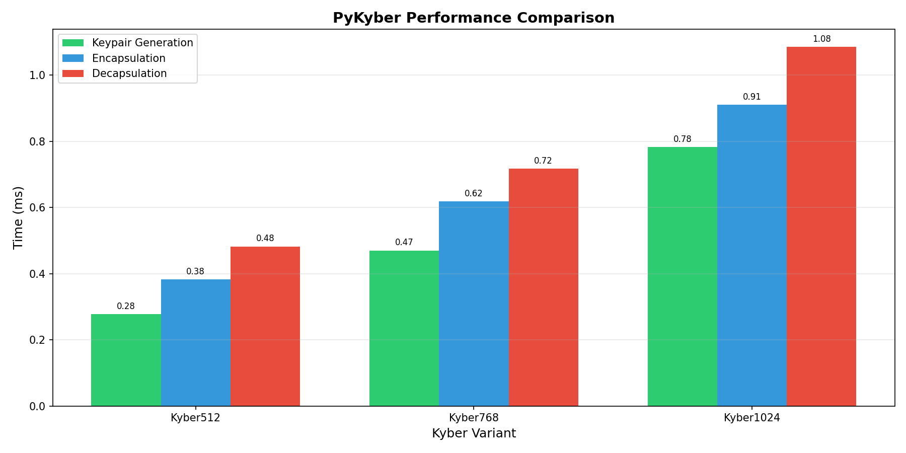
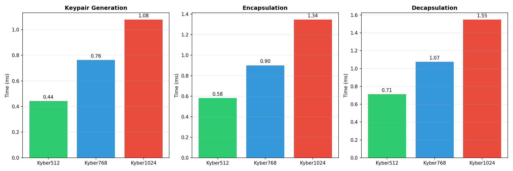
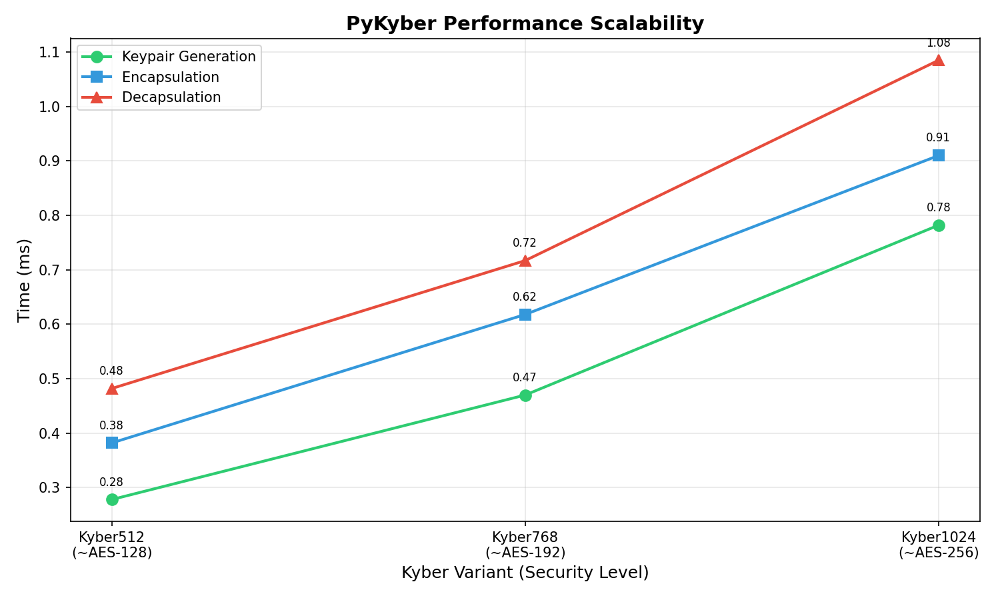
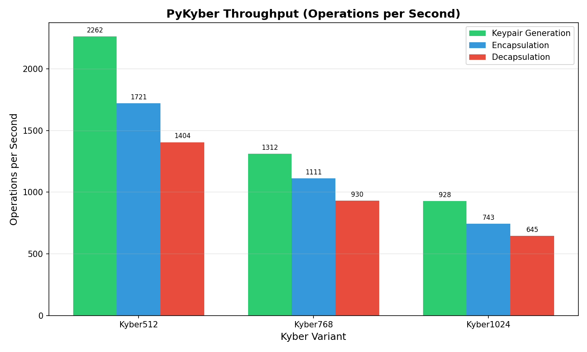

# PyKyber

A Python library for post-quantum key encapsulation, implemented in Rust: ML-KEM (FIPS 203), plus the legacy round-3 CRYSTALS-Kyber classes, which are deprecated.

ML-KEM and round-3 Kyber are not interoperable. If you are moving from Kyber, read the [migration guide](docs/migration.md) first.

## Installation

```bash
pip install pykyber
```

## Quick Start

```python
import pykyber

# Generate a keypair (Alice)
alice_keypair = pykyber.ML_KEM_768()

# Encapsulate - create shared secret (Bob)
bob_result = pykyber.ML_KEM_768.encapsulate(alice_keypair.public_key)

# Decapsulate - recover shared secret (Alice)
shared_secret = alice_keypair.decapsulate(bob_result.ciphertext)

# Both parties now share the same secret
print(f"Match: {bob_result.shared_secret == shared_secret}")
```

ML-KEM-768 is the parameter set NIST recommends as the default (FIPS 203, section 8).

## API Usage

```python
import pykyber

# Create a keypair - instant generation on class instantiation
keypair = pykyber.ML_KEM_512()    # security category 1
keypair = pykyber.ML_KEM_768()    # security category 3 (NIST default)
keypair = pykyber.ML_KEM_1024()   # security category 5

# Deterministic key generation from a 64-byte seed d || z (the seed is secret)
seed = bytes(range(64))
keypair = pykyber.ML_KEM_768(seed=seed)
assert keypair.seed == seed        # None for randomly generated keypairs

# Access raw key bytes
public_key = keypair.public_key    # bytes
secret_key = keypair.secret_key    # bytes

# Or unpack directly as tuple
public_key, secret_key = keypair   # same as above

# Encapsulate - create ciphertext and shared secret
result = keypair.encapsulate()
# result.ciphertext     - bytes to send to receiver
# result.shared_secret  - 32 bytes shared secret

# Serialization and Utilities
hex_pk = keypair.public_key_hex    # Get hex representation
b64_sk = keypair.secret_key_b64    # Get base64 representation
data = keypair.to_dict()           # Get dictionary of hex keys

# Encapsulation results also support serialization
ct_hex = result.ciphertext_hex
ss_b64 = result.shared_secret_b64

# Or unpack directly as tuple
ciphertext, shared_secret = keypair.encapsulate()   # same as above

# Decapsulate - recover shared secret from ciphertext
shared_secret = keypair.decapsulate(result.ciphertext)

# Static methods - use without creating a keypair instance

# Encapsulate with just a public key
result = pykyber.ML_KEM_768.encapsulate(public_key)

# Decapsulate with just ciphertext and secret key
shared_secret = pykyber.ML_KEM_768.decapsulate(result.ciphertext, secret_key)

# Load a Keypair object from existing keys
keypair = pykyber.ML_KEM_768.from_keys(public_key, secret_key)
```

## Key Sizes

| Variant     | Public Key | Secret Key | Ciphertext | Shared Secret |
|-------------|------------|------------|------------|---------------|
| ML-KEM-512  | 800 bytes  | 1632 bytes | 768 bytes  | 32 bytes      |
| ML-KEM-768  | 1184 bytes | 2400 bytes | 1088 bytes | 32 bytes      |
| ML-KEM-1024 | 1568 bytes | 3168 bytes | 1568 bytes | 32 bytes      |

The legacy Kyber classes use the same sizes, so a key or ciphertext cannot be identified as Kyber or ML-KEM from its length.

## Error Handling

All operations raise `KyberError`, or one of its subclasses, when invalid input is provided:

```python
import pykyber

try:
    pykyber.ML_KEM_768.encapsulate(b"too_short")
except pykyber.KyberError as e:
    print(e)
# Output: Invalid public_key for ML-KEM-768.encapsulate: expected 1184 bytes, got 9.
```

Common error cases:
- Invalid key, ciphertext or seed size: `InvalidInputError`
- Encapsulation key that fails the FIPS 203 section 7.2 check: `InvalidEncapsulationKeyError`
- Decapsulation key that fails the FIPS 203 section 7.3 check: `InvalidDecapsulationKeyError`
- An object of another algorithm: (a `Kyber*` keypair passed to an `ML_KEM_*` method, or another ML-KEM parameter set): `AlgorithmMismatchError`

A well-formed ciphertext that was not made for the key does not raise; decapsulation returns a different, pseudorandom secret (implicit rejection, FIPS 203).

## Deprecated: Kyber

`Kyber512`, `Kyber768` and `Kyber1024` implement round-3 CRYSTALS-Kyber. They still work and their output has not changed from 1.0.5, but they are deprecated in favor of ML-KEM: the first use of one in a process emits a `KyberDeprecationWarning` (a `DeprecationWarning`, which Python hides by default unless it is raised from `__main__`; run with `-W default::DeprecationWarning` to see it). The [migration guide](docs/migration.md) explains how to move.

## Security status

The ML-KEM code is checked against the official ACVP, C2SP CCTV and Wycheproof test vectors and against an independent implementation (a dev-only differential test). It has not been independently audited, and the side-channel review planned for 2.0 has not been completed, so this README makes no constant-time claim. Report vulnerabilities as described in [SECURITY.md](SECURITY.md). Secret keys and shared secrets are returned as immutable Python `bytes` that cannot be wiped from memory.


## Performance

Performance benchmarks of the legacy Kyber classes (100 iterations each; the benchmark has not been rerun for ML-KEM):

| Variant | Keypair | Encapsulate | Decapsulate |
|---------|---------|-------------|-------------|
| Kyber512 | 0.44 ms (2,262/s) | 0.58 ms (1,721/s) | 0.71 ms (1,404/s) |
| Kyber768 | 0.76 ms (1,312/s) | 0.90 ms (1,111/s) | 1.08 ms (930/s) |
| Kyber1024 | 1.08 ms (928/s) | 1.35 ms (743/s) | 1.55 ms (645/s) |

Run benchmarks and generate graphs:

```bash
make benchmark
```

Generated graphs:

### Performance Comparison


### Operation Breakdown


### Scalability


### Throughput



## License

This is free and unencumbered software released into the public domain.
See [LICENSE](LICENSE) or <https://unlicense.org>.
